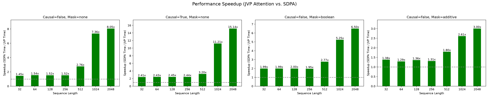
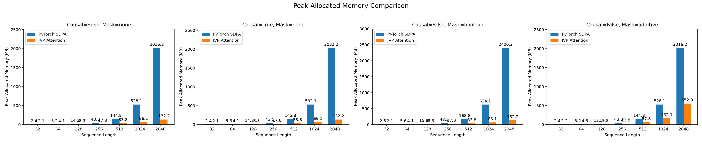

<div align="center">

# JVP Flash Attention

<a href="https://pytorch.org/get-started/locally/"></a>
[](https://doi.org/10.5281/zenodo.17050188)
[](https://badge.fury.io/py/jvp_flash_attention)
[](https://www.repostatus.org/#active)
<a href="https://github.com/psf/black"></a>
[](https://opensource.org/licenses/MIT)


</div>

## Description

Flash Attention Triton kernel (with a pure-PyTorch tiled fallback) supporting second-order derivatives, such as Jacobian-Vector Products (JVPs) and Hessian-Vector Products (HVPs)

## Installation

Using `pip`, one can install `jvp_flash_attention` as follows.

```bash
# Install package
pip install jvp_flash_attention

# [OPTIONAL, for development] Install package and pre-commit hooks
pip install -e .
pre-commit install
```

## Usage

Once installed, one can use `jvp_flash_attention` in place of PyTorch's `scaled_dot_product_attention` as follows.

```python
import torch.nn.functional as F

from torch.nn.attention import SDPBackend, sdpa_kernel
from jvp_flash_attention import JVPAttn, attention as jvp_attention

with sdpa_kernel(SDPBackend.MATH):
  # Regular (quadratic) attention
  x = F.scaled_dot_product_attention(
      q,
      k,
      v,
      attn_mask=attn_mask,
      dropout_p=attn_dropout_p if self.training else 0.0,
  )

# JVP flash attention
x = jvp_attention(
    q,
    k,
    v,
    attn_mask=attn_mask,
    # dropout_p=attn_dropout_p if self.training else 0.0,  # NOTE: Attention dropout is currently unsupported
)
```

Anecdotally, one can also swap out `F.scaled_dot_product_attention` with `jvp_attention` **even for pretrained models** with minimal impact on numerical accuracy.

> Note: If calling `torch.func.jvp` manually in your model's forward pass like
> `pred, df = torch.func.jvp(*(lambda x_jvp: model(x_jvp), (x,), (gt,)))`,
> make sure to use JVP Flash Attention in your model as `model = lambda q, k, v: JVPAttn.fwd_dual(q, k, v)` instead of as `model = lambda q, k, v: jvp_attention(q, k, v)` to ensure each input's tangent vectors are computed [prior](https://github.com/amorehead/jvp_flash_attention/issues/10) to running PyTorch's `autograd` engine. Dual inputs where only a subset of `(q, k, v)` carries tangents are also supported (including under `torch.compile`). Models that rely on `torch.autograd.grad` to compute higher-order derivatives in their forward pass (e.g., energy-based models) should not require this change.

### Backends and sequence lengths

- **Automatic pure-PyTorch tiled fallback (`USE_NAIVE`)**: By default (`USE_NAIVE=None`), `jvp_attention`, `JVPAttn.fwd`, and `JVPAttn.fwd_dual` run the Triton kernels on CUDA and automatically fall back to a pure-PyTorch tiled Flash Attention implementation (`jvp_flash_attention.naive_pytorch.naive_attention`, with `O(N)` saved state and configurable `q_bucket_size` / `k_bucket_size`) when Triton or CUDA is unavailable (e.g., CPU or macOS `cpu`/`mps`). Pass `USE_NAIVE=True` to force the pure-PyTorch path or `USE_NAIVE=False` to force Triton.
- **Arbitrary sequence lengths and rectangular `Q`/`KV`**: Any sequence length `>= 1` is supported (the Triton backend internally pads sequences up to a multiple of `min_sequence_length=32` and excises padding on forward and backward). Rectangular attention (`N_KV >= N_Q` with `N_Q != N_KV` when `attn_mask is None`, e.g., KV-cached autoregressive decoding) is also supported and routed to the tiled PyTorch path to avoid quadratic square padding.

Contributions or enhancements are welcome!

## Results

### Loss matching

Model training with either `F.scaled_dot_product_attention` or `JVPAttn.fwd_dual` produces the same loss trajectory.


### Speed matching

Model training with either `F.scaled_dot_product_attention` or `JVPAttn.fwd_dual` achieves the same iteration speed.


> Note: The following results can be reproduced (for `float32` precision) by running `python tests/test_jvp_attention.py --dtype float32`.

### Time scaling

`jvp_attention` outscales the speed of (`SDPBackend.MATH`-based) `F.scaled_dot_product_attention` when calculating second-order derivatives.

<div align="center">



</div>

### Memory scaling

`jvp_attention` improves the memory usage of (`SDPBackend.MATH`-based) `F.scaled_dot_product_attention` when calculating second-order derivatives.

<div align="center">



</div>

## Tests

If you want to run the `pytest` unit test suite (covering both the pure-PyTorch tiled backend and Triton kernels, sequence padding, KV-cached decoding, HVPs, and `torch.compile`) or the Triton kernel benchmark/validation suite, run the following command(s).

```bash
# Run pytest unit tests
pytest tests/test_naive_jvp_attention.py

# Run Triton kernel accuracy and scaling benchmarks
python tests/test_jvp_attention.py --dtype {float16,bfloat16,float32}
```

In principle, the Triton kernel should support ROCm systems as well, though it has not yet been tested on them. On CPU-only systems, macOS (`cpu` or Apple Silicon `mps`), or environments without Triton, `jvp_flash_attention` automatically falls back to its pure-PyTorch tiled JVP attention implementation.

Full results for `float16`:

```
==============================================================================================================
BENCHMARK SUMMARY
==============================================================================================================
Seq Len    Causal   Mask       Method     Time (ms)    Mem (MB)     TFLOP/s      Max Error    Grad Check
--------------------------------------------------------------------------------------------------------------
32         False    additive   sdpa       0.852        3.09           0.0 TFLOP/s baseline     N/A
32         False    additive   jvp_attn   0.584        1.08           0.0 TFLOP/s 2.15e-02     ✗

32         False    boolean    sdpa       0.942        3.14           0.0 TFLOP/s baseline     N/A
32         False    boolean    jvp_attn   0.422        1.03           0.0 TFLOP/s 3.91e-03     ✓

32         False    none       sdpa       0.625        3.09           0.0 TFLOP/s baseline     N/A
32         False    none       jvp_attn   0.354        1.03           0.0 TFLOP/s 1.95e-03     ✓

32         True     none       sdpa       0.956        3.10           0.0 TFLOP/s baseline     N/A
32         True     none       jvp_attn   0.354        1.03           0.0 TFLOP/s 3.91e-03     ✓

64         False    additive   sdpa       0.921        6.75           0.0 TFLOP/s baseline     N/A
64         False    additive   jvp_attn   0.638        2.26           0.1 TFLOP/s 1.07e-02     ✗

64         False    boolean    sdpa       0.952        6.94           0.0 TFLOP/s baseline     N/A
64         False    boolean    jvp_attn   0.426        2.07           0.1 TFLOP/s 3.91e-03     ✓

64         False    none       sdpa       0.633        6.75           0.0 TFLOP/s baseline     N/A
64         False    none       jvp_attn   0.360        2.07           0.1 TFLOP/s 1.95e-03     ✓

64         True     none       sdpa       0.962        6.77           0.0 TFLOP/s baseline     N/A
64         True     none       jvp_attn   0.359        2.07           0.1 TFLOP/s 2.20e-03     ✓

128        False    additive   sdpa       0.921        16.51          0.1 TFLOP/s baseline     N/A
128        False    additive   jvp_attn   0.603        4.89           0.3 TFLOP/s 3.91e-03     ✓

128        False    boolean    sdpa       0.953        17.26          0.1 TFLOP/s baseline     N/A
128        False    boolean    jvp_attn   0.427        4.14           0.5 TFLOP/s 3.91e-03     ✓

128        False    none       sdpa       0.636        16.51          0.2 TFLOP/s baseline     N/A
128        False    none       jvp_attn   0.361        4.14           0.6 TFLOP/s 9.77e-04     ✓

128        True     none       sdpa       0.969        16.57          0.1 TFLOP/s baseline     N/A
128        True     none       jvp_attn   0.361        4.14           0.3 TFLOP/s 2.44e-03     ✓

256        False    additive   sdpa       0.915        47.77          0.4 TFLOP/s baseline     N/A
256        False    additive   jvp_attn   0.618        12.02          1.3 TFLOP/s 3.91e-03     ✓

256        False    boolean    sdpa       0.954        50.77          0.4 TFLOP/s baseline     N/A
256        False    boolean    jvp_attn   0.430        8.27           1.9 TFLOP/s 3.91e-03     ✓

256        False    none       sdpa       0.633        47.27          0.6 TFLOP/s baseline     N/A
256        False    none       jvp_attn   0.363        8.27           2.3 TFLOP/s 9.77e-04     ✓

256        True     none       sdpa       0.966        47.52          0.2 TFLOP/s baseline     N/A
256        True     none       jvp_attn   0.363        8.27           1.1 TFLOP/s 3.91e-03     ✓

512        False    additive   sdpa       1.287        153.55         1.3 TFLOP/s baseline     N/A
512        False    additive   jvp_attn   0.628        29.05          5.2 TFLOP/s 1.95e-03     ✓

512        False    boolean    sdpa       1.304        165.05         1.3 TFLOP/s baseline     N/A
512        False    boolean    jvp_attn   0.438        16.55          7.5 TFLOP/s 1.95e-03     ✓

512        False    none       sdpa       1.108        153.05         1.5 TFLOP/s baseline     N/A
512        False    none       jvp_attn   0.357        16.55          9.2 TFLOP/s 4.88e-04     ✓

512        True     none       sdpa       1.270        154.05         0.6 TFLOP/s baseline     N/A
512        True     none       jvp_attn   0.357        16.55          4.6 TFLOP/s 2.93e-03     ✓

1024       False    additive   sdpa       4.440        546.84         1.5 TFLOP/s baseline     N/A
1024       False    additive   jvp_attn   1.043        90.75         12.6 TFLOP/s 1.95e-03     ✓

1024       False    boolean    sdpa       4.440        594.84         1.5 TFLOP/s baseline     N/A
1024       False    boolean    jvp_attn   0.570        33.84         23.1 TFLOP/s 1.95e-03     ✓

1024       False    none       sdpa       3.784        546.84         1.7 TFLOP/s baseline     N/A
1024       False    none       jvp_attn   0.367        33.84         35.8 TFLOP/s 4.88e-04     ✓

1024       True     none       sdpa       4.307        550.84         0.8 TFLOP/s baseline     N/A
1024       True     none       jvp_attn   0.363        33.84         18.1 TFLOP/s 3.91e-03     ✓

2048       False    additive   sdpa       16.629       2052.19        1.6 TFLOP/s baseline     N/A
2048       False    additive   jvp_attn   3.028        324.00        17.4 TFLOP/s 1.95e-03     ✓

2048       False    boolean    sdpa       16.616       2244.19        1.6 TFLOP/s baseline     N/A
2048       False    boolean    jvp_attn   1.530        66.19         34.3 TFLOP/s 1.95e-03     ✓

2048       False    none       sdpa       14.088       2052.19        1.9 TFLOP/s baseline     N/A
2048       False    none       jvp_attn   1.026        66.19         51.2 TFLOP/s 4.88e-04     ✓

2048       True     none       sdpa       16.265       2068.19        0.8 TFLOP/s baseline     N/A
2048       True     none       jvp_attn   0.647        66.19         40.6 TFLOP/s 1.95e-03     ✓


================================================================================
MASK TYPE PERFORMANCE COMPARISON
================================================================================
Seq Len    Causal   Method     No Mask         Boolean Mask    Additive Mask
--------------------------------------------------------------------------------
32         False    jvp_attn   0.35 ms         0.42 ms (1.19x) 0.58 ms (1.65x)
32         True     jvp_attn   0.35 ms         N/A             N/A
64         False    jvp_attn   0.36 ms         0.43 ms (1.19x) 0.64 ms (1.77x)
64         True     jvp_attn   0.36 ms         N/A             N/A
128        False    jvp_attn   0.36 ms         0.43 ms (1.18x) 0.60 ms (1.67x)
128        True     jvp_attn   0.36 ms         N/A             N/A
256        False    jvp_attn   0.36 ms         0.43 ms (1.19x) 0.62 ms (1.70x)
256        True     jvp_attn   0.36 ms         N/A             N/A
512        False    jvp_attn   0.36 ms         0.44 ms (1.23x) 0.63 ms (1.76x)
512        True     jvp_attn   0.36 ms         N/A             N/A
1024       False    jvp_attn   0.37 ms         0.57 ms (1.55x) 1.04 ms (2.84x)
1024       True     jvp_attn   0.36 ms         N/A             N/A
2048       False    jvp_attn   1.03 ms         1.53 ms (1.49x) 3.03 ms (2.95x)
2048       True     jvp_attn   0.65 ms         N/A             N/A

============================================================
STATISTICS
============================================================
Average speedup: 4.78x
Min speedup: 1.44x
Max speedup: 25.15x

Accuracy: 26/28 tests passed
⚠️  Some accuracy checks failed

Failed configurations:
  - Seq=32, Causal=False, Mask=additive
  - Seq=64, Causal=False, Mask=additive
```

Full results for `bfloat16`:

```
==============================================================================================================
BENCHMARK SUMMARY
==============================================================================================================
Seq Len    Causal   Mask       Method     Time (ms)    Mem (MB)     TFLOP/s      Max Error    Grad Check
--------------------------------------------------------------------------------------------------------------
32         False    additive   sdpa       0.913        3.09           0.0 TFLOP/s baseline     N/A
32         False    additive   jvp_attn   0.580        1.08           0.0 TFLOP/s 3.12e-02     ✓

32         False    boolean    sdpa       0.945        3.14           0.0 TFLOP/s baseline     N/A
32         False    boolean    jvp_attn   0.419        1.03           0.0 TFLOP/s 3.12e-02     ✓

32         False    none       sdpa       0.627        3.09           0.0 TFLOP/s baseline     N/A
32         False    none       jvp_attn   0.354        1.03           0.0 TFLOP/s 1.56e-02     ✓

32         True     none       sdpa       0.957        3.10           0.0 TFLOP/s baseline     N/A
32         True     none       jvp_attn   0.356        1.03           0.0 TFLOP/s 3.12e-02     ✓

64         False    additive   sdpa       0.922        6.75           0.0 TFLOP/s baseline     N/A
64         False    additive   jvp_attn   0.633        2.26           0.1 TFLOP/s 3.12e-02     ✓

64         False    boolean    sdpa       0.887        6.94           0.0 TFLOP/s baseline     N/A
64         False    boolean    jvp_attn   0.425        2.07           0.1 TFLOP/s 3.12e-02     ✓

64         False    none       sdpa       0.633        6.75           0.0 TFLOP/s baseline     N/A
64         False    none       jvp_attn   0.357        2.07           0.1 TFLOP/s 1.56e-02     ✓

64         True     none       sdpa       0.973        6.77           0.0 TFLOP/s baseline     N/A
64         True     none       jvp_attn   0.357        2.07           0.1 TFLOP/s 3.12e-02     ✓

128        False    additive   sdpa       0.920        16.51          0.1 TFLOP/s baseline     N/A
128        False    additive   jvp_attn   0.601        4.89           0.3 TFLOP/s 1.56e-02     ✓

128        False    boolean    sdpa       0.956        17.26          0.1 TFLOP/s baseline     N/A
128        False    boolean    jvp_attn   0.440        4.14           0.5 TFLOP/s 1.56e-02     ✓

128        False    none       sdpa       0.635        16.51          0.2 TFLOP/s baseline     N/A
128        False    none       jvp_attn   0.357        4.14           0.6 TFLOP/s 7.81e-03     ✓

128        True     none       sdpa       0.968        16.57          0.1 TFLOP/s baseline     N/A
128        True     none       jvp_attn   0.358        4.14           0.3 TFLOP/s 3.12e-02     ✓

256        False    additive   sdpa       0.916        47.77          0.4 TFLOP/s baseline     N/A
256        False    additive   jvp_attn   0.615        12.02          1.3 TFLOP/s 1.56e-02     ✓

256        False    boolean    sdpa       0.994        50.77          0.4 TFLOP/s baseline     N/A
256        False    boolean    jvp_attn   0.428        8.27           1.9 TFLOP/s 1.56e-02     ✓

256        False    none       sdpa       0.634        47.27          0.6 TFLOP/s baseline     N/A
256        False    none       jvp_attn   0.360        8.27           2.3 TFLOP/s 7.81e-03     ✓

256        True     none       sdpa       0.971        47.52          0.2 TFLOP/s baseline     N/A
256        True     none       jvp_attn   0.361        8.27           1.1 TFLOP/s 1.56e-02     ✓

512        False    additive   sdpa       1.283        153.55         1.3 TFLOP/s baseline     N/A
512        False    additive   jvp_attn   0.626        29.05          5.2 TFLOP/s 1.56e-02     ✓

512        False    boolean    sdpa       1.302        165.05         1.3 TFLOP/s baseline     N/A
512        False    boolean    jvp_attn   0.434        16.55          7.6 TFLOP/s 1.56e-02     ✓

512        False    none       sdpa       1.105        153.05         1.5 TFLOP/s baseline     N/A
512        False    none       jvp_attn   0.357        16.55          9.2 TFLOP/s 7.81e-03     ✓

512        True     none       sdpa       1.267        154.05         0.6 TFLOP/s baseline     N/A
512        True     none       jvp_attn   0.356        16.55          4.6 TFLOP/s 3.12e-02     ✓

1024       False    additive   sdpa       4.438        546.84         1.5 TFLOP/s baseline     N/A
1024       False    additive   jvp_attn   1.052        90.75         12.5 TFLOP/s 1.56e-02     ✓

1024       False    boolean    sdpa       4.439        594.84         1.5 TFLOP/s baseline     N/A
1024       False    boolean    jvp_attn   0.584        33.84         22.5 TFLOP/s 1.56e-02     ✓

1024       False    none       sdpa       3.784        546.84         1.7 TFLOP/s baseline     N/A
1024       False    none       jvp_attn   0.364        33.84         36.1 TFLOP/s 3.91e-03     ✓

1024       True     none       sdpa       4.305        550.84         0.8 TFLOP/s baseline     N/A
1024       True     none       jvp_attn   0.360        33.84         18.3 TFLOP/s 1.56e-02     ✓

2048       False    additive   sdpa       16.627       2052.19        1.6 TFLOP/s baseline     N/A
2048       False    additive   jvp_attn   3.075        324.00        17.1 TFLOP/s 1.56e-02     ✓

2048       False    boolean    sdpa       16.614       2244.19        1.6 TFLOP/s baseline     N/A
2048       False    boolean    jvp_attn   1.582        66.19         33.2 TFLOP/s 1.56e-02     ✓

2048       False    none       sdpa       14.087       2052.19        1.9 TFLOP/s baseline     N/A
2048       False    none       jvp_attn   1.064        66.19         49.4 TFLOP/s 3.91e-03     ✓

2048       True     none       sdpa       16.260       2068.19        0.8 TFLOP/s baseline     N/A
2048       True     none       jvp_attn   0.651        66.19         40.4 TFLOP/s 3.12e-02     ✓


================================================================================
MASK TYPE PERFORMANCE COMPARISON
================================================================================
Seq Len    Causal   Method     No Mask         Boolean Mask    Additive Mask
--------------------------------------------------------------------------------
32         False    jvp_attn   0.35 ms         0.42 ms (1.18x) 0.58 ms (1.64x)
32         True     jvp_attn   0.36 ms         N/A             N/A
64         False    jvp_attn   0.36 ms         0.42 ms (1.19x) 0.63 ms (1.78x)
64         True     jvp_attn   0.36 ms         N/A             N/A
128        False    jvp_attn   0.36 ms         0.44 ms (1.23x) 0.60 ms (1.68x)
128        True     jvp_attn   0.36 ms         N/A             N/A
256        False    jvp_attn   0.36 ms         0.43 ms (1.19x) 0.62 ms (1.71x)
256        True     jvp_attn   0.36 ms         N/A             N/A
512        False    jvp_attn   0.36 ms         0.43 ms (1.22x) 0.63 ms (1.76x)
512        True     jvp_attn   0.36 ms         N/A             N/A
1024       False    jvp_attn   0.36 ms         0.58 ms (1.61x) 1.05 ms (2.89x)
1024       True     jvp_attn   0.36 ms         N/A             N/A
2048       False    jvp_attn   1.06 ms         1.58 ms (1.49x) 3.07 ms (2.89x)
2048       True     jvp_attn   0.65 ms         N/A             N/A

============================================================
STATISTICS
============================================================
Average speedup: 4.74x
Min speedup: 1.46x
Max speedup: 24.99x

Accuracy: 28/28 tests passed
✓ All accuracy checks passed!
```

Full results for `float32`:

```
==============================================================================================================
BENCHMARK SUMMARY
==============================================================================================================
Seq Len    Causal   Mask       Method     Time (ms)    Mem (MB)     TFLOP/s      Max Error    Grad Check
--------------------------------------------------------------------------------------------------------------
32         False    additive   sdpa       0.817        2.44           0.0 TFLOP/s baseline     N/A
32         False    additive   jvp_attn   0.593        2.16           0.0 TFLOP/s 2.31e-02     ✓

32         False    boolean    sdpa       0.843        2.53           0.0 TFLOP/s baseline     N/A
32         False    boolean    jvp_attn   0.424        2.07           0.0 TFLOP/s 9.16e-03     ✓

32         False    none       sdpa       0.539        2.44           0.0 TFLOP/s baseline     N/A
32         False    none       jvp_attn   0.373        2.07           0.0 TFLOP/s 7.83e-03     ✓

32         True     none       sdpa       0.868        2.44           0.0 TFLOP/s baseline     N/A
32         True     none       jvp_attn   0.360        2.07           0.0 TFLOP/s 8.60e-03     ✓

64         False    additive   sdpa       0.820        5.25           0.0 TFLOP/s baseline     N/A
64         False    additive   jvp_attn   0.635        4.51           0.1 TFLOP/s 1.24e-02     ✓

64         False    boolean    sdpa       0.855        5.62           0.0 TFLOP/s baseline     N/A
64         False    boolean    jvp_attn   0.430        4.13           0.1 TFLOP/s 1.23e-02     ✓

64         False    none       sdpa       0.552        5.25           0.0 TFLOP/s baseline     N/A
64         False    none       jvp_attn   0.359        4.13           0.1 TFLOP/s 7.03e-03     ✓

64         True     none       sdpa       0.877        5.27           0.0 TFLOP/s baseline     N/A
64         True     none       jvp_attn   0.361        4.13           0.1 TFLOP/s 1.05e-02     ✓

128        False    additive   sdpa       0.823        13.51          0.1 TFLOP/s baseline     N/A
128        False    additive   jvp_attn   0.605        9.76           0.3 TFLOP/s 9.14e-03     ✓

128        False    boolean    sdpa       0.856        15.76          0.1 TFLOP/s baseline     N/A
128        False    boolean    jvp_attn   0.429        8.26           0.5 TFLOP/s 8.91e-03     ✓

128        False    none       sdpa       0.556        14.26          0.2 TFLOP/s baseline     N/A
128        False    none       jvp_attn   0.364        8.26           0.6 TFLOP/s 5.07e-03     ✓

128        True     none       sdpa       0.884        14.32          0.1 TFLOP/s baseline     N/A
128        True     none       jvp_attn   0.361        8.26           0.3 TFLOP/s 1.05e-02     ✓

256        False    additive   sdpa       0.813        43.27          0.5 TFLOP/s baseline     N/A
256        False    additive   jvp_attn   0.622        23.77          1.3 TFLOP/s 9.98e-03     ✓

256        False    boolean    sdpa       0.840        48.52          0.5 TFLOP/s baseline     N/A
256        False    boolean    jvp_attn   0.431        17.02          1.9 TFLOP/s 9.93e-03     ✓

256        False    none       sdpa       0.551        43.27          0.7 TFLOP/s baseline     N/A
256        False    none       jvp_attn   0.362        17.77          2.3 TFLOP/s 4.03e-03     ✓

256        True     none       sdpa       0.872        43.52          0.2 TFLOP/s baseline     N/A
256        True     none       jvp_attn   0.358        17.77          1.1 TFLOP/s 9.61e-03     ✓

512        False    additive   sdpa       1.197        144.80         1.4 TFLOP/s baseline     N/A
512        False    additive   jvp_attn   0.667        57.80          4.9 TFLOP/s 7.29e-03     ✓

512        False    boolean    sdpa       1.213        168.80         1.4 TFLOP/s baseline     N/A
512        False    boolean    jvp_attn   0.438        33.80          7.5 TFLOP/s 7.22e-03     ✓

512        False    none       sdpa       1.012        144.80         1.6 TFLOP/s baseline     N/A
512        False    none       jvp_attn   0.367        33.80          8.9 TFLOP/s 3.94e-03     ✓

512        True     none       sdpa       1.173        145.80         0.7 TFLOP/s baseline     N/A
512        True     none       jvp_attn   0.366        33.80          4.5 TFLOP/s 6.56e-03     ✓

1024       False    additive   sdpa       4.187        528.09         1.6 TFLOP/s baseline     N/A
1024       False    additive   jvp_attn   1.605        162.09         8.2 TFLOP/s 6.90e-03     ✓

1024       False    boolean    sdpa       4.199        624.09         1.6 TFLOP/s baseline     N/A
1024       False    boolean    jvp_attn   0.801        66.09         16.4 TFLOP/s 6.85e-03     ✓

1024       False    none       sdpa       3.540        528.09         1.9 TFLOP/s baseline     N/A
1024       False    none       jvp_attn   0.481        66.09         27.3 TFLOP/s 2.92e-03     ✓

1024       True     none       sdpa       4.063        532.09         0.8 TFLOP/s baseline     N/A
1024       True     none       jvp_attn   0.362        66.09         18.1 TFLOP/s 8.65e-03     ✓

2048       False    additive   sdpa       15.825       2016.19        1.7 TFLOP/s baseline     N/A
2048       False    additive   jvp_attn   5.271        552.00        10.0 TFLOP/s 7.22e-03     ✓

2048       False    boolean    sdpa       15.856       2400.19        1.7 TFLOP/s baseline     N/A
2048       False    boolean    jvp_attn   2.438        132.19        21.6 TFLOP/s 7.16e-03     ✓

2048       False    none       sdpa       13.288       2016.19        2.0 TFLOP/s baseline     N/A
2048       False    none       jvp_attn   1.650        132.19        31.8 TFLOP/s 2.61e-03     ✓

2048       True     none       sdpa       15.470       2032.19        0.8 TFLOP/s baseline     N/A
2048       True     none       jvp_attn   1.022        132.19        25.7 TFLOP/s 7.71e-03     ✓


================================================================================
MASK TYPE PERFORMANCE COMPARISON
================================================================================
Seq Len    Causal   Method     No Mask         Boolean Mask    Additive Mask
--------------------------------------------------------------------------------
32         False    jvp_attn   0.37 ms         0.42 ms (1.14x) 0.59 ms (1.59x)
32         True     jvp_attn   0.36 ms         N/A             N/A
64         False    jvp_attn   0.36 ms         0.43 ms (1.20x) 0.64 ms (1.77x)
64         True     jvp_attn   0.36 ms         N/A             N/A
128        False    jvp_attn   0.36 ms         0.43 ms (1.18x) 0.60 ms (1.66x)
128        True     jvp_attn   0.36 ms         N/A             N/A
256        False    jvp_attn   0.36 ms         0.43 ms (1.19x) 0.62 ms (1.72x)
256        True     jvp_attn   0.36 ms         N/A             N/A
512        False    jvp_attn   0.37 ms         0.44 ms (1.19x) 0.67 ms (1.82x)
512        True     jvp_attn   0.37 ms         N/A             N/A
1024       False    jvp_attn   0.48 ms         0.80 ms (1.66x) 1.61 ms (3.34x)
1024       True     jvp_attn   0.36 ms         N/A             N/A
2048       False    jvp_attn   1.65 ms         2.44 ms (1.48x) 5.27 ms (3.19x)
2048       True     jvp_attn   1.02 ms         N/A             N/A

============================================================
STATISTICS
============================================================
Average speedup: 3.52x
Min speedup: 1.29x
Max speedup: 15.14x

Accuracy: 28/28 tests passed
✓ All accuracy checks passed!
```

Note: Based on these results, for all precision types, it is recommended to provide a boolean `attn_mask` to `jvp_attention()` where possible.

## License

This project is covered under the **MIT License**.

## Copyright

JVP Flash Attention (jvp_flash_attention) Copyright (c) 2025, The Regents of the University of California, through Lawrence Berkeley National Laboratory (subject to receipt of any required approvals from the U.S. Dept. of Energy). All rights reserved.

If you have questions about your rights to use or distribute this software,
please contact Berkeley Lab's Intellectual Property Office at
IPO@lbl.gov.

**NOTICE.** This Software was developed under funding from the U.S. Department
of Energy and the U.S. Government consequently retains certain rights. As
such, the U.S. Government has been granted for itself and others acting on
its behalf a paid-up, nonexclusive, irrevocable, worldwide license in the
Software to reproduce, distribute copies to the public, prepare derivative
works, and perform publicly and display publicly, and to permit others to do so.

## Citing this work

If you use the code associated with this package or otherwise find this work useful, please use GitHub's `Cite this repository` feature or the BibTeX below.

```bibtex
@software{Morehead_JVP_Flash_Attention_2025,
  author = {Morehead, Alex},
  doi = {10.5281/zenodo.17050188},
  license = {MIT},
  month = sep,
  title = {{JVP Flash Attention}},
  url = {https://github.com/amorehead/jvp_flash_attention},
  version = {0.15.0},
  year = {2025}
}
```

## Demonstrated use cases

- [EchoLVFM (MICCAI 2026)](https://github.com/EngEmmanuel/EchoLVFM)
- [Self-Play Pretraining with Zero Data (arXiv 2026)](https://arxiv.org/abs/2609.30063)

## Acknowledgements

`jvp_flash_attention` builds upon the contributions and insights from the following sources:

- [flash-attention](https://github.com/Dao-AILab/flash-attention)
  - [JVP Triton kernel thread](https://github.com/Dao-AILab/flash-attention/issues/1672)
    - [benjamin-dinkelmann](https://gist.github.com/benjamin-dinkelmann)
    - *[Birch-san](https://github.com/Birch-san)*
    - [dabeschte](https://github.com/dabeschte)
    - [IsaacYQH](https://gist.github.com/IsaacYQH)
    - [KohakuBlueleaf](https://github.com/KohakuBlueleaf)
    - [leon](https://github.com/leon532)
    - [limsanky](https://github.com/limsanky)
    - [lucidrains](https://github.com/lucidrains)
    - [Peterande](https://gist.github.com/Peterande)
    - *[Ryu1845](https://github.com/Ryu1845)*
    - [tridao](https://github.com/tridao)

Thank you to each and every contributor!
